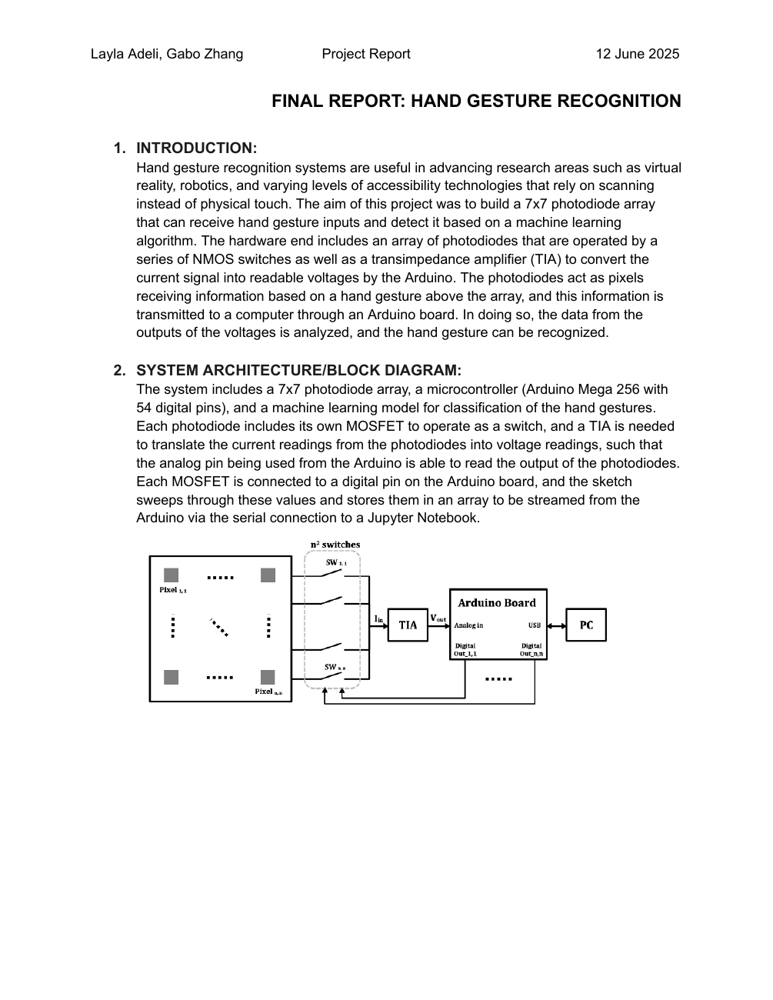
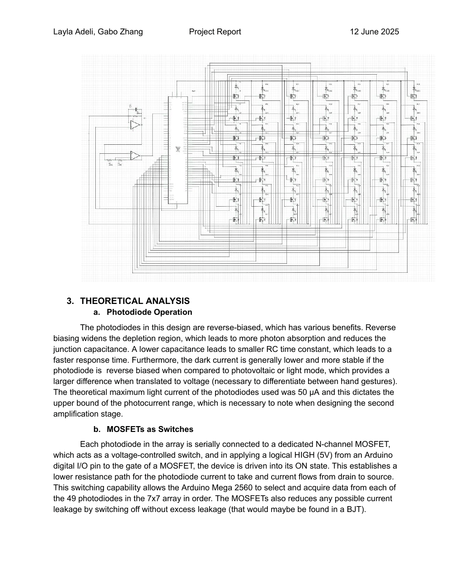
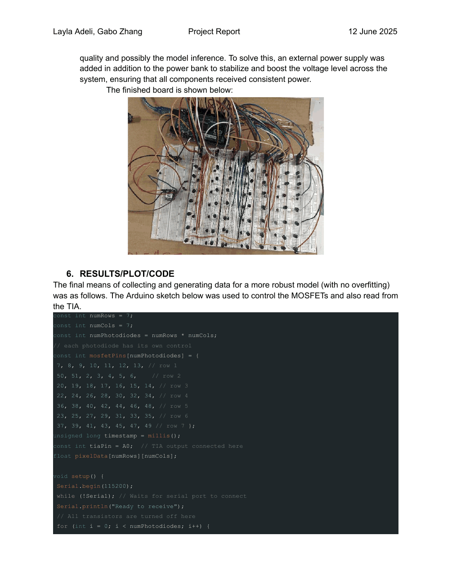
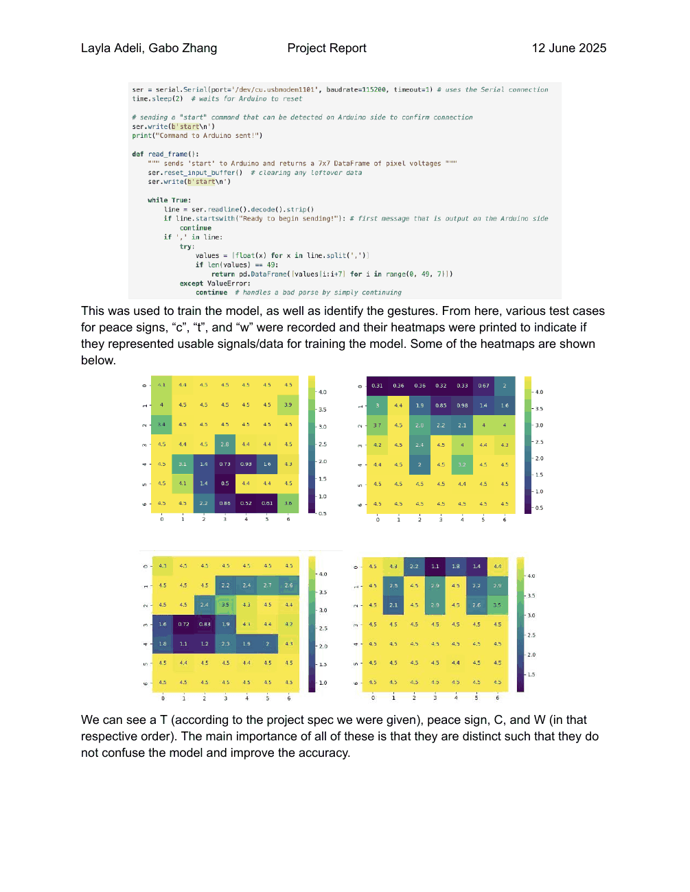
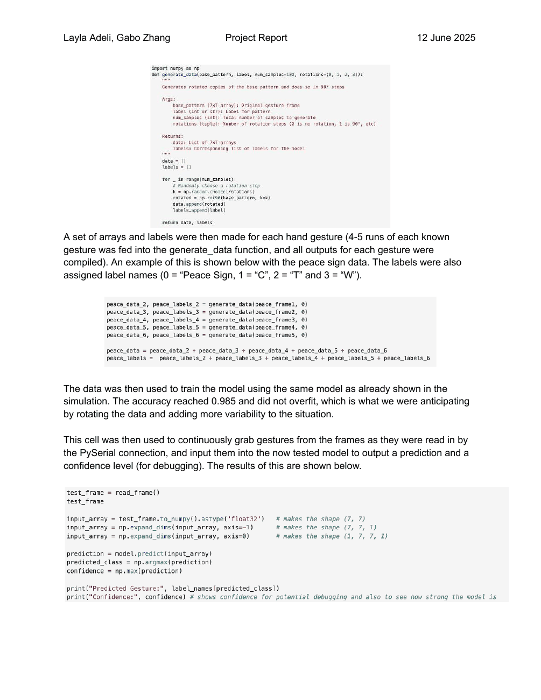
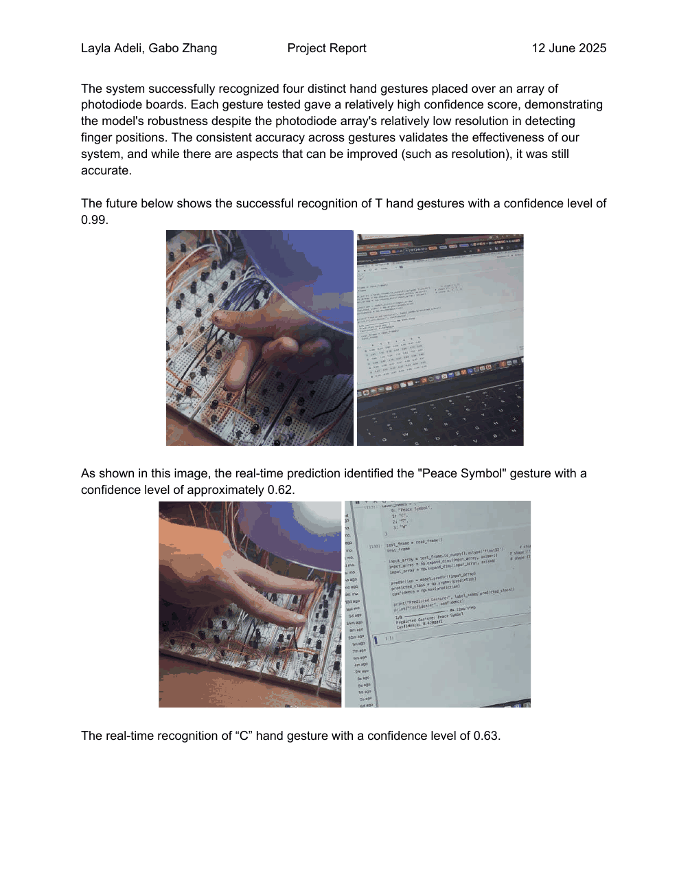

# Hand gesture recognition

A two-person project by **Layla Adeli and Gabo Zhang**, documented in the [final report, 12 June 2025](report.pdf). A 7×7 photodiode array converts a hand's shadow into a low-resolution image for a four-class gesture classifier. The report supplies hardware, firmware and model evidence that is not present in the short `hand_rec.ipynb` alone.

## Array, switching and analog readout

The 49 reverse-biased photodiodes each have a dedicated series N-channel MOSFET. An Arduino Mega 2560 drives each gate from its own digital output: HIGH selects one pixel, LOW deselects it. This is **not** an electrically row/column-addressed 14-wire switch matrix; row/column indexing describes spatial layout and scan order. Selected photocurrent feeds a shared TIA and then an inverting gain stage into A0. The report describes a parallel feedback resistor/capacitor for current-to-voltage conversion and stability; multiple resistor combinations were tried, as annotated in its schematic. First-stage behavior is `Vout = -I_PD Rf`; the following stage gives a signal suitable for the nominal 0–5 V, 10-bit ADC range.

The report's statement that reverse bias generally lowers dark current relative to photovoltaic operation should not be taken as a general photodiode design rule. Reverse bias reduces junction capacitance and can improve speed, but introduces dark-current/noise trade-offs. No unreported bias voltage or finalized resistor value is assumed here.

## Arduino interface and 7×7 mapping

`gesture_array.ino` is **transcribed from report pages 6–7**, with formatting and comments normalized; it is not a separately supplied original sketch. The printed pin array's closing `};` appears after a `// row 7` comment; the transcription places it on its own line so it is not commented out. No other code-token changes were made. It initializes every switch LOW, waits for the newline-terminated command `start`, then sweeps row-major. Each selected pixel settles for 17 ms, averages 166 `analogRead(A0)` samples, converts to volts with `average * 5 / 1023`, switches off and waits another 17 ms. A completed frame is one comma-separated line of 49 voltages, preceded by a command acknowledgement. Host parsers must skip status lines. Contrary to the report's continuous-stream wording, the printed sketch produces **one frame per `start` command**; the host must request subsequent frames. The declared timestamp is unused and not transmitted. Delays alone impose ≥1.666 s per frame, before ADC and serial overhead; this is a sequential image, not an instantaneous exposure.

The sketch's gate pin order is:

| Spatial row | Columns 1 → 7: Arduino digital pins |
| --- | --- |
| 1 | 7, 8, 9, 10, 11, 12, 13 |
| 2 | 50, 51, 2, 3, 4, 5, 6 |
| 3 | 20, 19, 18, 17, 16, 15, 14 |
| 4 | 22, 24, 26, 28, 30, 32, 34 |
| 5 | 36, 38, 40, 42, 44, 46, 48 |
| 6 | 23, 25, 27, 29, 31, 33, 35 |
| 7 | 37, 39, 41, 43, 45, 47, 49 |

Zero-based index `7 * row + col` maps both the pin table and the serial frame into a `(7, 7)` image, then `(1, 7, 7, 1)` for inference. The physical viewing orientation must be checked against the report photos; a flipped or rotated board is not automatically corrected by this mapping. The report describes repairing a split-breadboard power discontinuity and adding external power to stabilize readings; no new power wiring is inferred here.

## Model in the report versus the provided notebook

The report's CNN takes `(7,7,1)` input, applies `Conv2D(8, kernel_size=3, activation='relu')`, Flatten, Dense(16, ReLU, L2 regularization), Dropout(0.2), and a softmax output. It uses Adam and sparse categorical cross-entropy. The shown simulation initially uses five classes; the report says the ambiguous O class was removed, leaving **Peace, C, T and W**, labeled 0, 1, 2 and 3 respectively. It describes 25 training epochs, synthetic shadows (0 = hand/shadow, 1 = bright) augmented with noise, perturbations and pixel dropouts, followed by training on recorded gestures (4–5 runs per gesture) with additional variability. The complete acquisition, augmentation and training notebook and trained weights were not supplied as executable files.

`hand_rec.ipynb` is a **different, incomplete Sign Language MNIST preprocessing experiment**, not the report's finished four-class classifier. Its only code cell imports pandas, NumPy, TensorFlow/Keras and CNN layer classes, loads `sign_mnist_train.csv` / `sign_mnist_test.csv`, reshapes 784 pixels to `(N,28,28,1)`, divides by 255 and uses TensorFlow area resizing to `(N,7,7,1)`. At this exact integer scale each output cell aggregates a 4×4 image region, matching the array's dimensionality, not establishing a validated sensor-to-MNIST intensity calibration. The cell comments list 27455 training and 7172 test images. There is **no constructed model, fit call, evaluation or inference** in this notebook. Its saved execution ends in `ModuleNotFoundError: No module named 'tensorflow'`; no trained Sign Language MNIST accuracy can be claimed from it. The CSV datasets are absent.

## Results and reproducibility

The report gives approximately 0.97 simulated accuracy, 0.996 for a three-gesture trial and 0.985 after measured-data training, but does not provide a reproducible dataset split here. These figures are report claims, not independently verified generalization metrics. Demonstration screenshots show T/W confidence about 0.99, Peace about 0.62 and C about 0.63; single-frame confidence is not aggregate accuracy.

The transcribed Arduino sketch uses the standard Arduino core and Serial/ADC interfaces; use a matching sketch folder when importing into the IDE. The notebook requires pandas, NumPy and TensorFlow plus the missing CSVs. PySerial/Jupyter acquisition and the final CNN are documented in the report but not available as complete runnable source. No firmware compilation, model training or hardware validation was performed here. The original 24 MB report remains in the download directory; this archive includes a Ghostscript `/ebook` compressed copy (about 1.1 MB).
